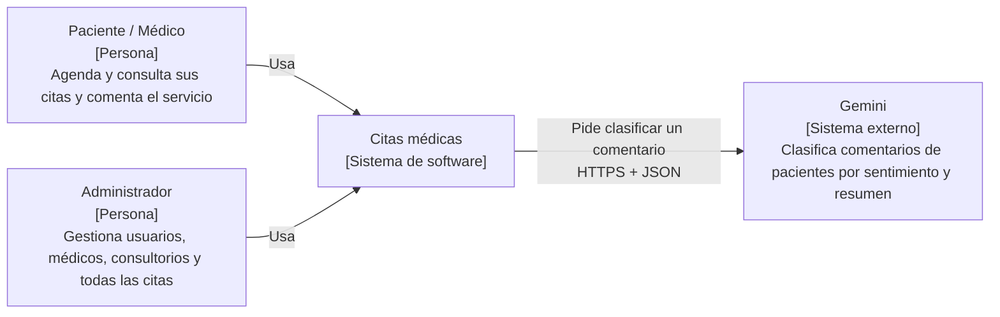
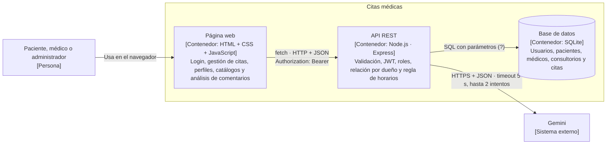

# Arquitectura

## Nivel 1 · Contexto

## Nivel 2 · Contenedores

## Qué pasa si algo falla

| Si falla... | Qué responde la API | Por qué |
|---|---|---|
| Gemini tarda más de 5 segundos | `504` | La API corta la espera con `AbortSignal.timeout(5000)` para no quedarse colgada y el front muestra un aviso claro. |
| Gemini devuelve un error (`4xx`/`5xx`), no hay conexión o responde algo distinto al JSON esperado | `502` | El fallo está en el servicio externo (si responde `5xx`, la API reintenta una vez antes de devolver `502`; con `4xx` no reintenta). |
| Falta `GEMINI_API_KEY` apuntando al servicio real | `503` | La integración de IA no está configurada; el resto de la API (login, citas, catálogos) sigue operando normalmente. |
| La página viene de un origen fuera de `CORS_ORIGENES` | El navegador bloquea | La política CORS en la API solo autoriza los orígenes configurados, protegiendo la sesión del usuario frente a sitios ajenos. |
| El cliente manda JSON roto o datos fuera de regla | `400` / `422` | La API rechaza la entrada antes de tocar la base de datos e indica el motivo o los campos con error. |
